<div align="center">

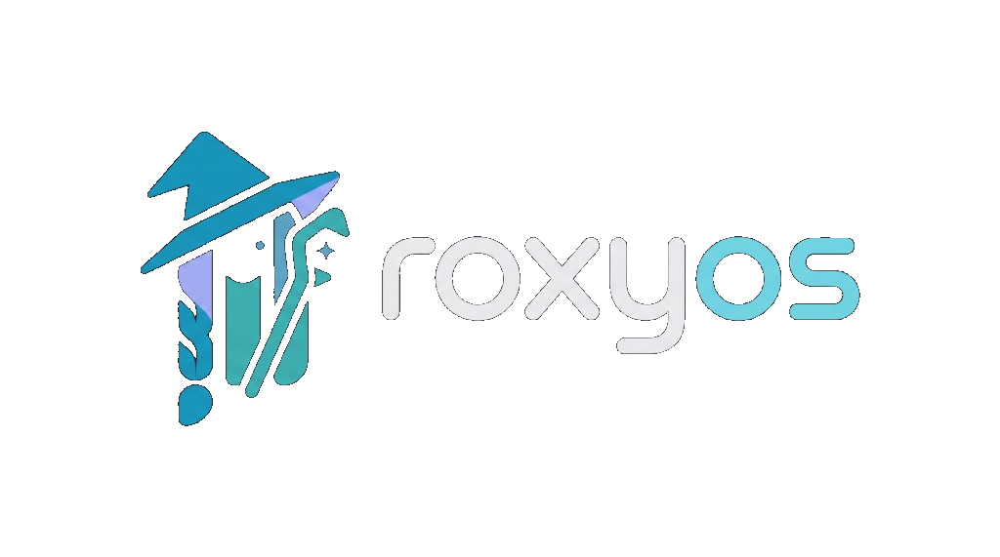

# ✧ RoxyOS: Mushoku Tensei System Suite ✧
### *A Complete Celestial Blue & Water-Magic Desktop Suite for Arch Linux & GNOME*

[](https://archlinux.org/)
[](https://www.gnome.org/)
[](https://gitlab.gnome.org/GNOME/libadwaita)
[](https://mushokutensei.fandom.com/wiki/Roxy_Migurdia)
[](https://opensource.org/licenses/MIT)

<br/>

<p align="center">
  <b>RoxyOS</b> is a self-contained, turnkey visual and auditory transformation suite inspired by <b>Roxy Migurdia</b> from <i>Mushoku Tensei: Jobless Reincarnation</i>. Designed for <b>Arch Linux</b> and modern <b>GNOME</b>, it seamlessly transforms every level of the operating system stack—including the <b>GRUB bootloader</b>, <b>Plymouth bootsplash</b>, <b>GDM greeter</b>, <b>GNOME Shell</b>, <b>Libadwaita / GTK4 styling</b>, <b>vector icon suite</b>, <b>Aqua Heartia cursors</b>, <b>terminal CLI</b>, and <b>hydrological sound effects</b>.
</p>

[✨ Live Preview](#-live-preview) •
[🌟 Features](#-key-features) •
[📂 Repository Structure](#-repository-structure) •
[🚀 Automated Installation](#-automated-installation-arch-linux) •
[🌓 Dual Theme Engine](#-dynamic-dual-theme-engine--light-mode-fix) •
[⚙️ GNOME Settings Integration](#-upstream-gnome-settings-transformation) •
[📜 Credits](#-credits--acknowledgments)

---

</div>

## 📸 Live Preview

<div align="center">
  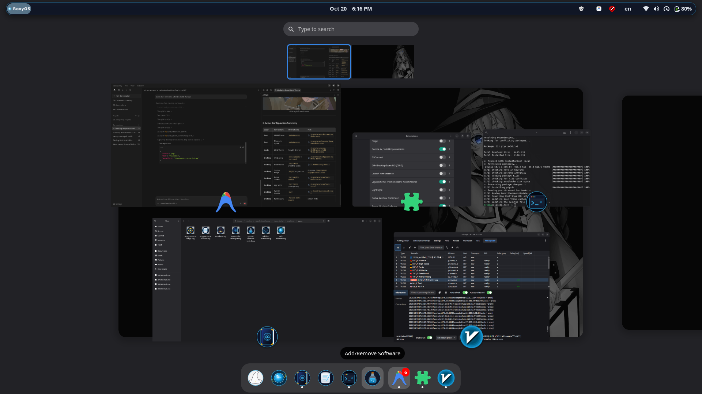
  <p><i>Live Desktop: Floating glass top bar, glowing RoxyOS badge, Papirus water-magic vector icons, and Aqua Heartia cursor.</i></p>
</div>

---

## 🌟 Key Features

### 1. 🖥️ Floating Glass Shell & Top Bar
- **Floating Island Bar**: Custom GNOME Shell CSS transforming the panel into a suspended glass capsule with `24px` rounded corners, semi-transparent deep slate-blue background (`rgba(15, 23, 42, 0.78)`), and subtle water-magic cyan glow outline.
- **Dedicated RoxyOS Top Bar Badge Extension**: Replaces the generic "Activities" button with an animated **`RoxyOS`** glowing cyan badge and indicator dot. Clicking it toggles the GNOME overview seamlessly.
- **Frosted App Grid**: Midnight glass backdrop (`rgba(10, 16, 30, 0.72)`), cyan capsule search bar, rounded glass folders, and glowing aura focus tiles.

<div align="center">
  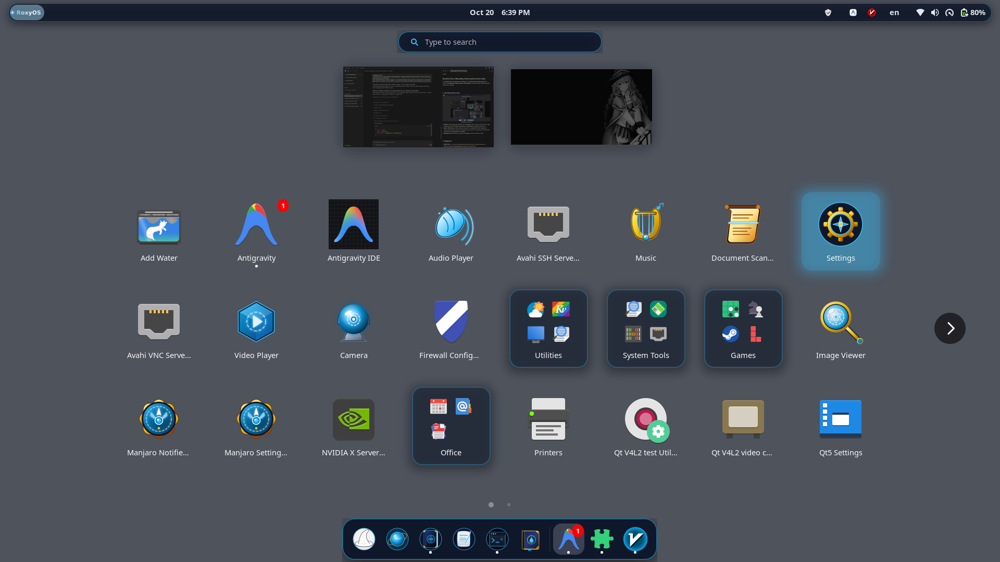
</div>

---

### 2. 🧙 Custom Water-Magic Vector Icons (100% Alpha Transparency)
Handcrafted borderless vector SVG icons injected directly into the `Papirus` and `Papirus-Dark` icon themes. **All dark background badges and black circles have been removed**, allowing icons to float cleanly on light docks, dark docks, or wallpapers alike:

| Application | Thematic Emblem | Design Details |
| :--- | :--- | :--- |
| **App Launcher / Grid** | 🧙 **Roxy's Witch Hat** | Pointed witch hat with golden band and floating celestial water crystal |
| **Files (Nautilus)** | 📖 **Water Grimoire** | Roxy's spellbook bound in sapphire leather with golden rune brackets |
| **Web Browser (Firefox/Chrome)** | 🔮 **Scrying Orb** | Swirling water sphere surrounded by golden astrolabe orbital rings |
| **Terminal (Console/Ptyxis)** | 💻 **Arcane Tablet** | Carved slate runestone displaying glowing cyan `>_` terminal prompt |
| **Text Editor** | 📜 **Spell Scroll** | Unrolled magic parchment and enchanted feather quill |
| **Software Store** | 🧪 **Mana Potion / Arcana**| Alchemical glass vial bubbling with luminous mana elixir |
| **Settings (Control Center)** | ⚙️ **Arcane Astrolabe** | Migurdia water seal combined with golden celestial compass points |
| **Music Player (GNOME Music)** | 🪕 **Enchanted Lyre** | Bardic water harp strung with glowing celestial filaments |
| **Camera (Snapshot)** | 📷 **Scrying Lens** | Concentric optical crystal held by rune-inscribed silver claws |
| **Video Player (Showtime)** | 📽️ **Projection Crystal**| Illusory floating quartz casting a holographic play rune |
| **Audio Recorder (Decibels)** | 🐚 **Siren's Conch** | Resonant spiral shell projecting harmonic ripples |
| **Document Scanner (SimpleScan)**| 📜 **Translation Scroll** | Ancient manuscript scanned by a focused runic beam |
| **Image Viewer (Loupe)** | 🔍 **Clairvoyance Lens** | Magnifying talisman revealing concentric water rings |

<div align="center">
  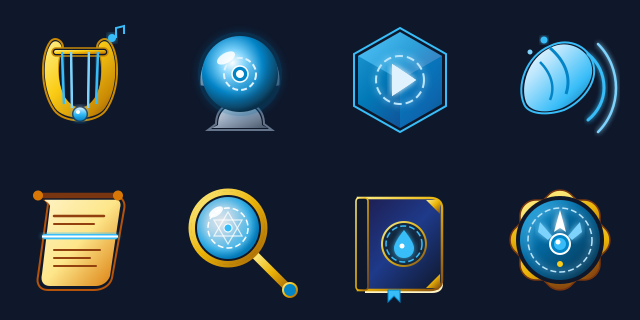
</div>

---

### 3. 🪄 Bespoke Aqua Heartia Cursor Suite (`roxy-magic-cursor`)
Compiled natively with `xcursorgen` across multiple HiDPI scales (**24px**, **32px**, and **48px**) with comprehensive support for X11 and Wayland sessions:

<div align="center">
  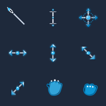
</div>

- **Normal Pointer (`default`, `arrow`)**: Roxy's iconic **Aqua Heartia** magic staff with a faceted glowing water crystal tip.
- **Link Pointer (`pointer`, `hand2`)**: Magic wand emitting an illuminated, floating water droplet.
- **Loading / Busy Spinner (`wait`, `watch`)**: 16-frame rotating cyan **Water Magic Circle**.
- **Typing (`ibeam`, `text`, `xterm`)**: Vertical water-magic wand with dual glowing cyan crystal tips and silver serifs.
- **Moving Windows (`move`, `all-scroll`, `size_all`)**: 4-directional arcane water compass with rotating runic ring and cyan arrow points.
- **Window Resize (`ew-resize`, `ns-resize`, `nwse-resize`, `nesw-resize`)**: Double-ended horizontal, vertical, and diagonal water crystal lances.
- **Grab & Grabbing (`grab`, `grabbing`)**: Open water gauntlet and clenched runic fist.

---

### 4. 🌓 Dynamic Dual Theme Engine & Light Mode Fix
Full day/night switching across GTK4 apps, shell chrome, and dock launchers without color bleeding or unreadable text:

<div align="center">
  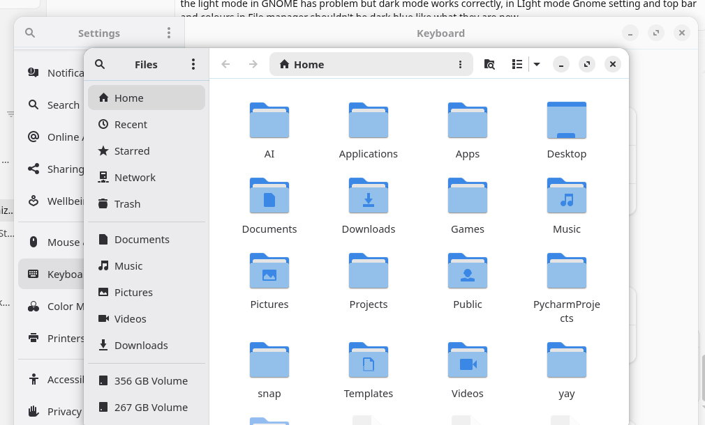
  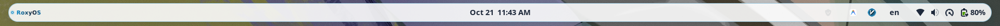
</div>

#### Clean Alpha Dock Launchers
Custom SVGs are stripped of any hardcoded background geometry (`#0b1329` discs), giving them natural transparency on any dock style or desktop background:

<div align="center">
  
</div>

#### Scoped GTK4 / Libadwaita Overrides
In `~/.config/gtk-4.0/gtk.css`, dark backgrounds are cleanly scoped inside `@media (prefers-color-scheme: dark)`. In Light Mode, native high-contrast surfaces (`#f8fafc`) and dark typography are preserved.

#### Frosted Ice Top Bar (`roxy-shell-light`)
Swaps the dark floating pill for a translucent frosted ice top bar (`rgba(255, 255, 255, 0.88)`) with slate labels and a light-mode RoxyOS badge.

#### Background Theme Synchronizer Daemon
The included `roxy-theme-sync.service` listens to D-Bus/GSettings `color-scheme` events to dynamically synchronize:
- `org.gnome.shell.extensions.user-theme`: `roxy-shell` ⇄ `roxy-shell-light`
- `org.gnome.desktop.interface gtk-theme`: `adw-gtk3-dark` ⇄ `adw-gtk3`

---

### 5. ⚙️ Upstream GNOME Settings Transformation
Integrates directly into GNOME's native C / Libadwaita Control Center (`gnome-control-center`), featuring high-resolution vector artwork in place of standard branding:

<div align="center">
  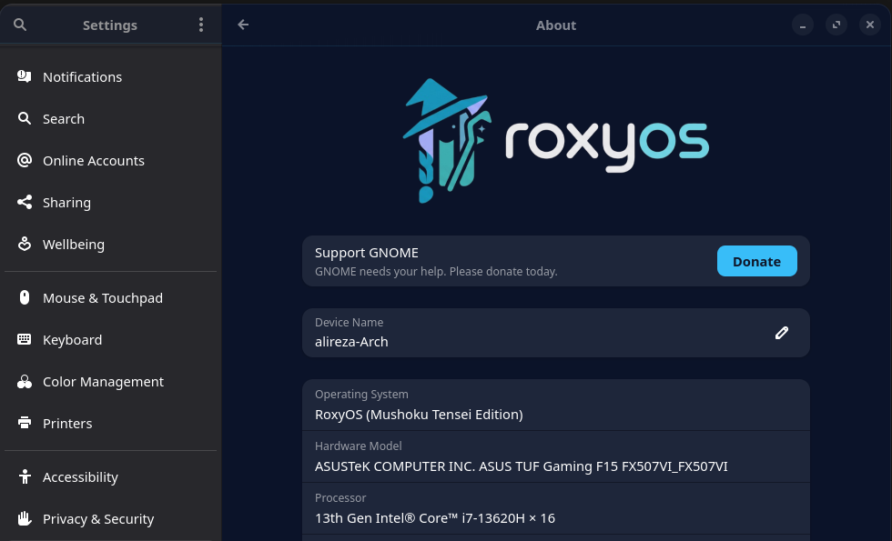
</div>

- **Direct Vector Placement**: Deploys bespoke vector SVGs featuring Roxy's witch hat, braids, Aqua Heartia wand, and typography into `/usr/share/icons/hicolor/` and `/usr/share/pixmaps/`.
- **Distribution Metadata**: Updates `/etc/os-release` to reflect `NAME="RoxyOS"`, `PRETTY_NAME="RoxyOS (Mushoku Tensei Edition)"`, and `LOGO=roxyos`.
- **Pure Native Speed**: Zero wrapper scripts or third-party settings apps; launches GNOME's native control center instantly.

---

### 6. 💻 Terminal CLI & Shell Theming
- **24-bit TrueColor ANSI Half-Block Portrait**: Crisp ASCII/ANSI rendering of Roxy Migurdia with water-magic potion vial (`~/.config/fastfetch/roxy.txt`).
- **Fastfetch Theme**: Formatted with celestial water dividers (`✦`), title banner (`✧ {user} @ RoxyOS ✧`), and system telemetry.
- **ZSH & Powerlevel10k**: Sapphire blue (`#0284c7`) and celestial cyan (`#38bdf8`) segments with custom `✧ RoxyOS` identity tag.
- **Fish Shell**: Two-line water-magic prompt (`╭─✧ ~/path ➜`) with automated Fastfetch launch.

---

### 7. 🔊 Hydrological Sound Suite
Custom sound theme deployed to `/usr/share/sounds/roxy/`:
- **Desktop Login (`desktop-login.oga`)**: Rising water-magic swell accompanied by celestial chime fanfare.
- **Volume Feedback (`audio-volume-change.oga`)**: Resonant water droplet *plink* (frequency sweep from 1200Hz to 2600Hz).
- **Trash Empty (`trash-empty.oga`)**: Swirling water vortex with dissipating droplets.
- **System Notification (`message.oga`)**: Luminous celestial harp arpeggio.
- **Alert / Bell (`bell.oga`)**: Deep resonant water temple bell.

---

### 8. 🚀 Bootloader & Bootsplash Themes

| Component | Preview | Description |
| :--- | :---: | :--- |
| **GRUB 2 Bootloader** | 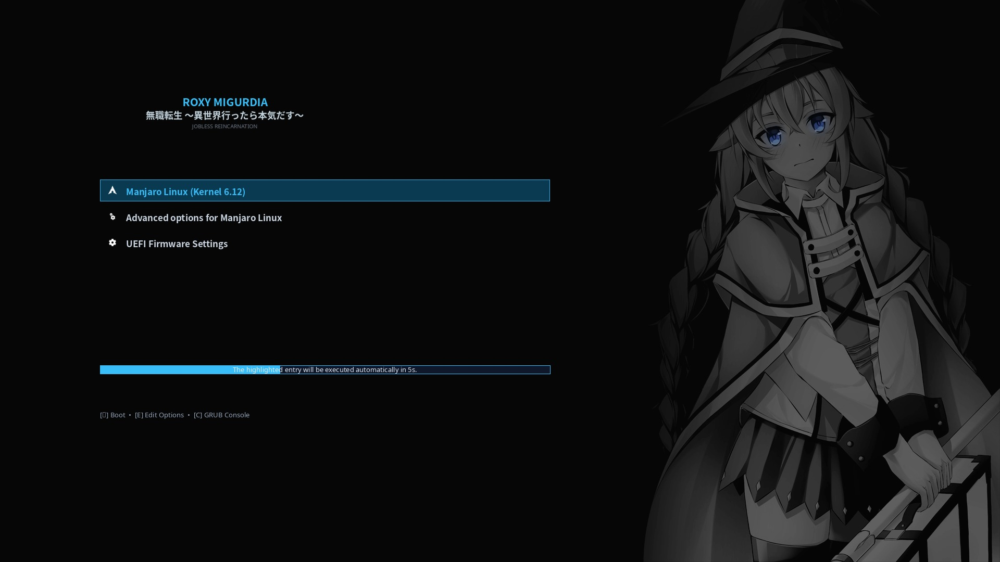 | Deep celestial wallpaper, illuminated cyan boot selection pill, and custom font styling. |
| **Plymouth Bootsplash** | 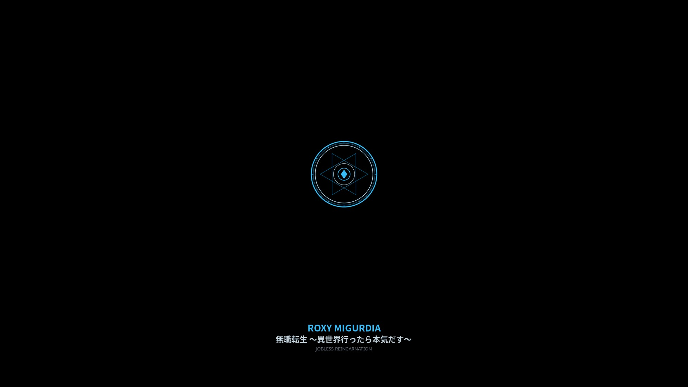 | Smooth animated Water Magic Circle rotating during kernel boot. |
| **GDM Login Screen** | 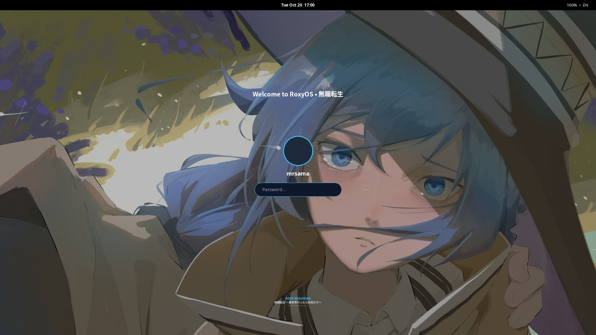 | Custom GDM Shell theme with water-magic lock screen shield and blurred backdrop. |

---

## 📂 Repository Structure

```
roxyos/
├── assets/                     # Screenshots, mockups, and visual assets
├── boot/
│   ├── grub/mushoku-roxy/      # GRUB theme (theme.txt, fonts, background, icons)
│   └── plymouth/mushoku-roxy/  # Plymouth theme (animation frames, plymouth script)
├── branding/                   # RoxyOS horizontal & square logos, os-release template
├── config/
│   ├── fastfetch/              # Fastfetch config.jsonc and ANSI roxy.txt
│   ├── gtk-4.0/                # Libadwaita responsive gtk.css
│   ├── scripts/                # roxy-theme-sync Python daemon
│   ├── shell/                  # Fish and ZSH prompt snippets
│   └── systemd/                # roxy-theme-sync.service systemd user unit
├── extensions/
│   ├── roxy-topbar-badge/      # GNOME Shell extension for topbar RoxyOS badge
│   └── mouse-tail/             # Glowing cyan water-magic mouse trail extension
├── icons/
│   ├── apps/                   # Clean transparent water-magic vector app SVGs
│   └── roxy-magic-cursor/      # Aqua Heartia cursor suite (24px, 32px, 48px)
├── sounds/                     # Hydrological sound suite (stereo .oga files)
├── themes/
│   ├── roxy-shell/             # GNOME Shell Dark Theme
│   └── roxy-shell-light/       # GNOME Shell Light Theme (Frosted Ice)
├── wallpapers/                 # High-resolution light and dark wallpapers
├── install.sh                  # Comprehensive, automated Arch Linux installer
├── uninstall.sh                # Clean uninstaller & system restorer
└── LICENSE                     # MIT License
```

---

## 🚀 Automated Installation (Arch Linux)

The installer is engineered specifically for **Arch Linux**. It automatically detects missing dependencies via `pacman`, installs them, sets up boot configurations, compiles schemas, and enables all components.

### 1. Clone & Run Installer
```bash
git clone https://github.com/your-username/roxyos.git
cd roxyos
chmod +x install.sh uninstall.sh
sudo ./install.sh
```

### 2. What `install.sh` Does Automatically
1. **Dependency Verification**: Checks and installs packages via `pacman`:
   - `gnome-shell`, `gnome-control-center`, `gnome-shell-extensions`
   - `fastfetch`, `papirus-icon-theme`, `adw-gtk-theme` (or `adw-gtk3`)
   - `plymouth`, `grub`, `xorg-xcursorgen`, `python`, `python-gobject`, `imagemagick`
2. **Wallpapers**: Deploys light and dark backgrounds to `/usr/share/backgrounds/mushoku-tensei/`.
3. **Shell Themes**: Installs `roxy-shell` and `roxy-shell-light` to `/usr/share/themes/` and activates user themes.
4. **Cursors**: Deploys `roxy-magic-cursor` and sets active cursor size to `32`.
5. **App Icons**: Injects alpha-transparent SVGs into Papirus and rebuilds icon caches.
6. **GNOME Settings**: Updates upstream Control Center branding in `/usr/share/icons/hicolor/` and `/usr/share/pixmaps/`, and configures `/etc/os-release`.
7. **Extensions**: Installs and activates `roxy-topbar-badge@mushoku.local` and `mouse-tail@lanesun.anlbrain.com`.
8. **Audio Suite**: Deploys the water-magic sound theme to `/usr/share/sounds/roxy/`.
9. **Theme Daemon**: Configures and starts `roxy-theme-sync.service` for live light/dark mode adaptation.
10. **Boot Themes**: Configures `/etc/default/grub` (regenerates config) and configures Plymouth (`mushoku-roxy`).

---

## 🔄 Reverting / Uninstallation

To revert all changes back to standard upstream GNOME and default bootloader configuration:
```bash
sudo ./uninstall.sh
```

---

## 📜 Credits & Acknowledgments

- **Character Design**: Rifujin na Magonote & Shirotaka (*Mushoku Tensei: Isekai Ittara Honki Dasu*).
- **Icon Base**: [Papirus Icon Theme](https://github.com/PapirusDevelopmentTeam/papirus-icon-theme) licensed under LGPL-3.0.
- **GTK Theme Base**: [adw-gtk3](https://github.com/lassekongo83/adw-gtk3) for legacy GTK3 application styling.
- **Cursor Engine**: Built natively with X11 `xcursorgen`.

---

<div align="center">
  <sub>Crafted with water-magic passion for fans of Roxy Migurdia. ✧ <i>Pure Arch Linux approved.</i></sub>
</div>
